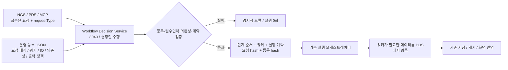

# Workflow Decision Service

라야 모델·Codex 계획·PDS 지식 카탈로그 대신 **명시된 요청 종류를 등록된 실행 계약에 연결**하는 독립 서비스다. 실행 오케스트레이터 `workflow-service`(8060)와 구분한다.

## 책임과 데이터 흐름



- 요청의 자연어는 워커용 의도다. `/v1/workflow-selections`는 자연어를 추론하거나 키워드 점수를 산출하지 않는다.
- `requestType`는 제품 경계에서 부여한 명시적 요청 종류이며 JSON의 `requestTypes`에서 정확히 조회한다.
- `actions`는 사용 가능한 워커의 IO·선행 단계·결과 수·확정 정책이다. 기존 어댑터를 재조합하는 등록 변경은 선택 코드 분기를 추가하지 않는다. 새 종류의 실행 능력은 별도 어댑터 구현이 필요하다.
- 지식 CRUD/지식 guidance는 이 서비스에서 지원하지 않는다. 기본 파일은 활성 실행 계약에서 추출·검증한 32개 단계/23개 요청 매핑이며 지식 서비스에 런타임 의존하지 않는다.
- 요청이 registry·workerId를 선택기에 주입할 수 없다. 설정은 서버가 지정한 로컬 파일만 읽는다.
- 전후 등록 hash가 바뀌면 실패한다. 자동 재시도, 다른 모델 fallback, 워커 실행, 임시 생성 파일은 없다.
- 기존 `selectionQuality.score=1`은 실행기 v3 계약 호환용 충족 여부이고 확률이 아니다. `basis=deterministic-registered-contract-not-probability`로 명시한다.

## 실행

저장소의 `contracts/`와 이 디렉터리를 같은 release에 배치한다.

```sh
cd workflow-decision-service
python3 run.py --host 127.0.0.1 --port 8040
```

선택적 `--registry-path`로 운영 설정 파일을 지정할 수 있다. 원자적으로 파일을 교체하고 기존 schema/adapters/IO 제약을 통과해야 한다. 기본 설정은 버전 관리된다. 새 모델이나 지식 DB, 외부 패키지는 필요 없다.

## HTTP 계약

- `GET /health`: 설정 유효성 및 서비스 정체성
- `GET /v1/worker-registry`: 운영 등록과 hash
- `POST /v1/request-routing`: `{ "requestType": "npc.create-overview" }`
- `POST /v1/workflow-selections`: `{ "mode": "single", "requestType": "npc.create-overview", "request": { "schemaVersion": "...", "...": "접수된 원본 필드" } }`
- 선택 응답은 기존 `ngs.npc-workflow-selection.v3`의 stages/invocations/outputPolicy/requestHash를 보존한다. provenance는 `workflowSource`, 선택 방식은 `registered-workflow-code`다.
- health 외 API는 loopback 주소·Host 확인 및 Origin 거절로 브라우저 직접 실행을 차단한다. POST는 최대 100,000 bytes다.

## 작업 후 상태 조건

- 성공: 등록된 워커만 포함, 요청과 반환 requestHash 일치, registryHash·workflowSource hash 일치, 단일 요청은 한 단계, 집계는 의존성·데이터 IO 순서 충족, 결과 수 계약 일치.
- 결정 실패: 실행 호출 0회, 모델 호출 0회, fallback 0회, 사용자 원본/임시/최종 데이터 변경 없음.
- 결정 성공도 콘텐츠 생성·저장 성공을 의미하지 않는다. 실행 이후 상태 검증은 기존 오케스트레이터와 워커의 책임이다.
- 서비스 소스 작성/테스트와 운영 포트 전환/배포/실제 콘텐츠 생성은 별도 확인한다.

## 기존 feature 준비 경계

`POST /v1/selections`는 기존 8060 오케스트레이터를 위한 별도 호환 API다. 명시 `featureId`를 읽기 전용 준비 액션에 연결하며 Catalog의 서비스·액션·템플릿 **메타데이터만** 읽는다. 지식 본문은 읽지 않는다. 기존 video-alpha의 단순 의도 키워드 분기를 보존한다. 장면 인물 선택은 PDS의 정본 장면·NPC 스냅샷을 조회한다. 이 경계 역시 모델이나 워커를 실행하지 않는다. 따라서 핵심 워크플로우 결정은 Catalog/PDS 없이 동작하지만 이 레거시 feature 준비는 해당 서비스의 가용성이 필요하다.

### Formal route admission

`requestTypes[].requestContract` adds shape-only admission before a plan is returned. Category generation validates the actual category envelope, target, revision, intent and add/modify scope. Category removal uses its exact five-field schema. Portrait/pixel requests bind canonical reference metadata, pose, result count, `setActive=false`, and pixel regeneration/reprocessing flags to the selected route. Missing fields or an arbitrary `schemaVersion` are not valid fixtures for these routes.

Animation generation/regeneration admits pixel references only. Existing pose-expansion portrait references are a distinct supported contract and are not silently changed. Frame extraction accepts well-formed registered/history preset IDs rather than two hardcoded names; the execution worker must still verify the exact eight published source slots. Selection is not proof that source files exist, that the actor owns them, or that their revision is current. Those authorization/CAS/readback checks remain mandatory at execution.


### Explicit NPC field correction

`npc.field.modify` selects `field-modify` / `npc-field-edit` once, with zero model calls. The initial admitted field is `role`; no free-form object patch or inferred value is accepted. The `ngs.npc-field-edit-request.v1` envelope requires `projectId`, `requestId`, `npcId`, `field`, `value`, `baseRevision`, `expectedCharacterHash`, `incarnationId`, and `userEvidence`. Values are preserved exactly rather than normalized. The worker must recheck authority and source CAS, change only the admitted field, publish via the existing canonical path and return a verified receipt. Selection alone does not modify a character.
